# Active Directory Authentication Attack Detection & SOC Investigation Lab

## Project Overview

This project demonstrates an end-to-end Security Operations Center (SOC) workflow for detecting, investigating, remediating, and verifying a simulated authentication attack in a Windows Active Directory environment.

The scenario involved a controlled authentication attack originating from a Kali Linux machine against a domain-connected Windows endpoint. The activity generated repeated failed authentication events before a successful authentication was observed.

Security telemetry was collected and investigated using **Wazuh, Splunk, Windows Security Event Logs, and Sysmon**.

The investigation focused on answering the following questions:

- What source generated the authentication failures?
- Which user account was targeted?
- Was there a successful authentication following the failed attempts?
- Did suspicious activity occur after authentication?
- Were suspicious processes or LOLBins executed?
- Were suspicious network connections established?
- What remediation actions were necessary?
- Did the containment control successfully block the attack source?

The project follows the SOC incident lifecycle:

> **Attack Simulation → Detection → Investigation → Findings → Remediation → Verification**

---

# Lab Environment

The lab consisted of multiple systems performing different security and infrastructure roles.

| System | Role |
|---|---|
| **Kali Linux** | Controlled attack simulation |
| **WIN10-PRO01** | Windows domain-connected target endpoint |
| **DC01** | Active Directory Domain Controller |
| **Wazuh Server** | Security monitoring and detection |
| **Splunk Enterprise** | Log analysis and investigation |
| **Sysmon** | Endpoint process and network telemetry |

### Relevant Lab Systems

- **Kali Linux IP:** `192.168.1.166`
- **WIN10-PRO01 IP:** `192.168.1.195`
- **DC01 IP:** `192.168.1.132`
- **Wazuh IP:** `192.168.1.114`
- **Splunk IP:** `192.168.1.127`

---

#  Project Objectives

The objectives of this project were to:

1. Simulate a controlled authentication attack from Kali Linux.
2. Detect repeated failed authentication activity.
3. Identify the attack source and targeted account.
4. Investigate authentication activity using Wazuh and Splunk.
5. Determine whether successful authentication followed the failed attempts.
6. Review endpoint telemetry for suspicious post-authentication activity.
7. Investigate process execution for suspicious binaries and LOLBins.
8. Analyze network connections during the investigation period.
9. Implement remediation and containment controls.
10. Verify that the containment action successfully blocked the identified attack source.

---

#  Detection and Monitoring Architecture

The Windows systems generated security and endpoint telemetry.

The telemetry was collected through:

- Windows Security Event Logs
- Sysmon
- Wazuh Agent

Wazuh was used to monitor and detect suspicious security events, while Splunk was used to perform focused investigation and telemetry analysis.

### Security Workflow

```text
Kali Linux
192.168.1.166
        │
        │ Authentication attempts
        ▼
WIN10-PRO01
192.168.1.195
        │
        ├── Windows Security Logs
        ├── Sysmon Telemetry
        └── Wazuh Agent
                │
                ▼
          Wazuh Manager
                │
                ▼
         Detection & Alerts
                │
                ▼
        Splunk Investigation
                │
                ▼
     Findings and Remediation
```

---

#  Attack Scenario

A controlled authentication attack was performed from the Kali Linux machine against **WIN10-PRO01**.

The attacker system used the IP address:

```text
192.168.1.166
```

The target endpoint was:

```text
WIN10-PRO01
192.168.1.195
```

Before the authentication testing, the target was identified as reachable and SMB was available on TCP port 445.

The controlled activity generated multiple failed network authentication attempts against the Windows environment.

The targeted domain account was:

```text
CORP\grace.adeyemi
```

The attack activity produced repeated failed authentication events and was later followed by successful authentication.

This created a realistic investigation scenario involving:

- Repeated failed authentication
- Source IP attribution
- Successful authentication analysis
- Post-authentication activity review
- Remediation and containment

---

# 🔎 Initial Network Reconnaissance

Before the authentication testing, the target endpoint was scanned to identify exposed services.

The scan showed:

```text
445/tcp open microsoft-ds
3389/tcp filtered
5985/tcp filtered
5986/tcp filtered
```

This confirmed that SMB was accessible on TCP port `445`.

### Evidence

> **Screenshot:** Initial Nmap scan showing SMB port 445 open.

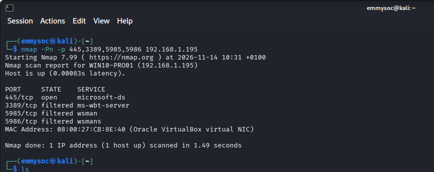

---

#  Detection

## Windows Authentication Events

The authentication activity generated Windows Security Event ID:

### Event ID 4625 — Failed Logon

Wazuh captured repeated failed authentication events associated with the controlled attack.

Important investigation fields included:

- Target username
- Source IP address
- Authentication package
- Logon type
- Workstation name

The events identified the Kali system as the source:

```text
Source IP: 192.168.1.166
```

The authentication activity involved:

```text
User: grace.adeyemi
Logon Type: 3
Authentication Package: NTLM
```

Logon Type `3` represented a network logon event, which was relevant to the SMB-based authentication activity.

### Evidence

> **Screenshot:** Wazuh alert showing failed authentication activity and source IP.

 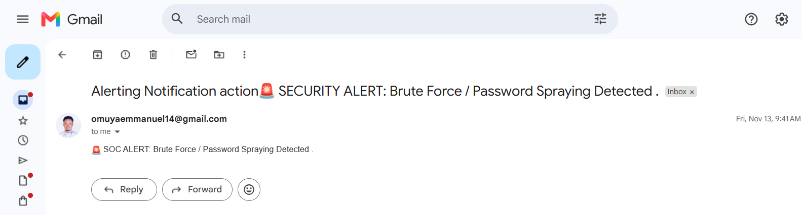

 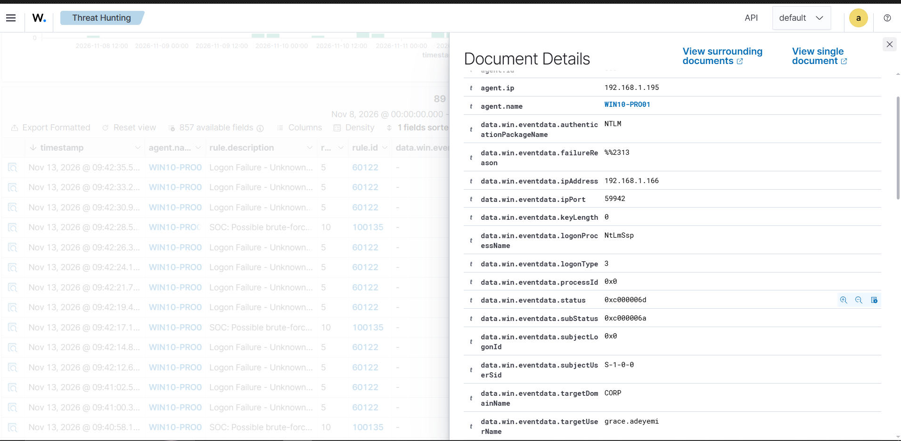


---

#  Custom SOC Detection Rule

A custom Wazuh detection rule was configured to identify repeated failed network logons originating from the same source IP address.

### Rule ID

```text
100135
```

### Detection Logic

The rule monitored failed Windows network authentication events and correlated multiple failures from the same source IP.

The rule was configured with:

- **Rule ID:** `100135`
- **Level:** `10`
- **Frequency:** `5`
- **Timeframe:** `120 seconds`
- **Base event:** Failed network logon
- **Correlation:** Same source IP address

The detection logic was designed to identify repeated authentication failures that could indicate brute-force or automated authentication activity.

### Detection Rule

```xml
<rule id="100135" level="10" frequency="5" timeframe="120">
  <if_matched_sid>60122</if_matched_sid>
  <field name="win.eventdata.logonType">^3$</field>
  <same_field>win.eventdata.ipAddress</same_field>
  <description>SOC: Possible brute-force activity - 5 failed network logons from $(win.eventdata.ipAddress)</description>
  <group>authentication_failed,network_logon,brute_force,windows_security,</group>
</rule>
```

### Evidence

> **Screenshot:** Wazuh custom detection rule configuration.


---

# 🔍 Investigation

The investigation was performed using **Wazuh and Splunk**.

The goal was not only to confirm the authentication attack but also to determine whether the attacker performed additional suspicious activity after authentication.

The investigation focused on three major areas:

1. Authentication activity
2. Process execution
3. Network connections

---

# 1️⃣ Authentication Investigation

The authentication investigation focused on identifying:

- Repeated failed logons
- The source IP address
- The targeted user account
- Successful authentication following the failed attempts

The investigation identified:

```text
Attack Source: 192.168.1.166
Target User: grace.adeyemi
Target System: WIN10-PRO01
Authentication Type: Network Logon
Authentication Package: NTLM
```

Repeated authentication failures were observed from the Kali attack machine.

The authentication timeline was then reviewed to determine whether successful authentication occurred after the failed attempts.

### Investigation Outcome

The activity confirmed that repeated authentication attempts originated from the Kali Linux system and that authentication activity involving the targeted account required investigation.

### Evidence

> **Screenshot:** Splunk authentication search results showing failed authentication events.

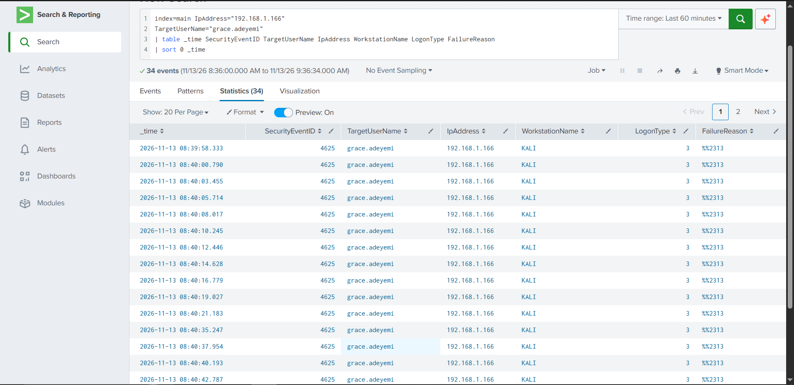

> **Screenshot:** Evidence showing successful authentication activity.

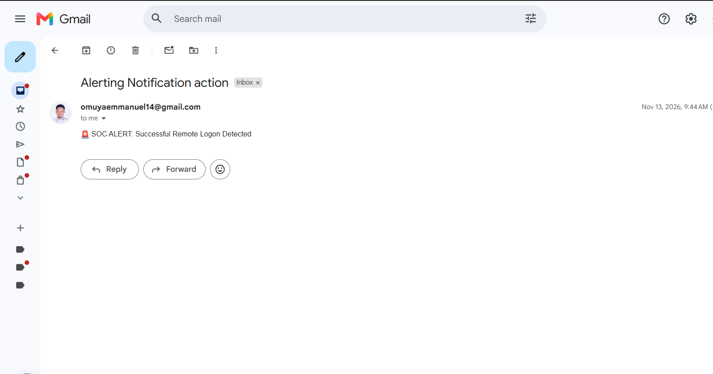
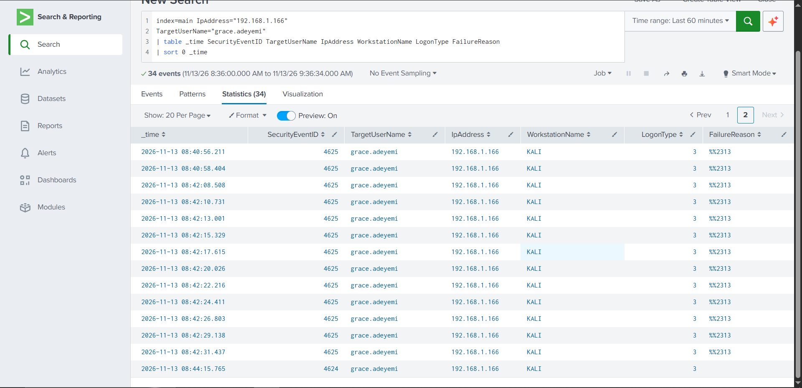

---

# 2️⃣ Process Execution Investigation

After reviewing authentication activity, the investigation examined Sysmon process creation telemetry.

### Sysmon Event ID 1

Sysmon Event ID `1` was used to investigate process creation activity.

The investigation reviewed:

- Process image
- Command line
- Parent image
- Parent command line
- User context

The purpose was to determine whether suspicious processes were launched following the authentication activity.

The investigation specifically considered potentially high-risk executables and commonly abused LOLBins, including:

- `powershell.exe`
- `cmd.exe`
- `mshta.exe`
- `wmic.exe`
- `rundll32.exe`

The investigation also reviewed parent processes and command-line information to provide additional context around process execution.

### Investigation Finding

No suspicious post-authentication process execution was identified during the reviewed investigation period.

### Evidence

> **Screenshot:** Splunk process execution investigation.

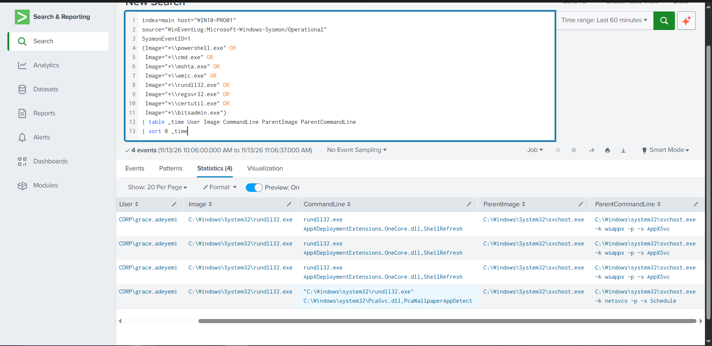
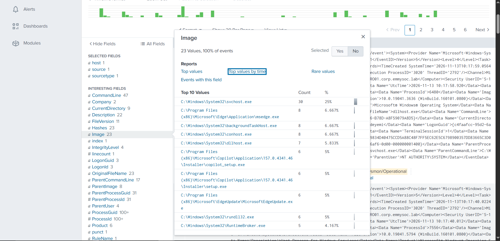
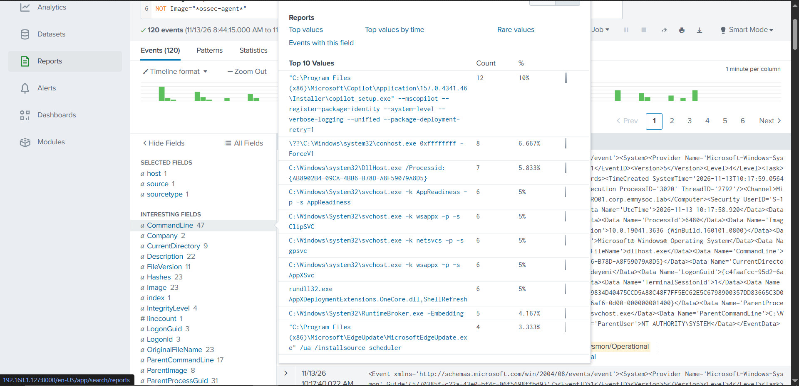


---

# 3️⃣ Network Connection Investigation

The investigation also reviewed Sysmon network connection telemetry.

### Sysmon Event ID 3

Sysmon Event ID `3` was used to examine network connections generated by the endpoint.

The investigation reviewed:

- Destination IP addresses
- Destination ports
- Protocols
- Associated processes
- Hostnames

The investigation identified normal and expected environment traffic, including communication associated with:

- Active Directory infrastructure
- DNS
- Microsoft services
- Splunk Universal Forwarder
- Normal endpoint processes

The analysis did not identify suspicious network connections attributable to malicious post-authentication activity during the investigation window.

### Investigation Finding

No suspicious outbound network activity, malicious downloads, or clearly suspicious connections were identified during the reviewed investigation period.

### Evidence

> **Screenshot:** Splunk Sysmon Event ID 3 network connection analysis.

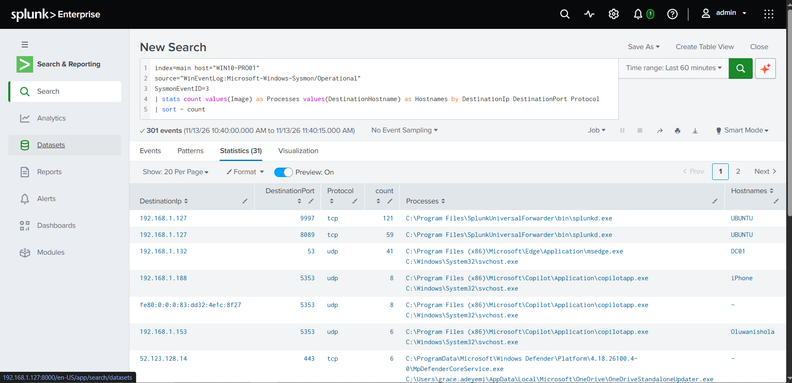
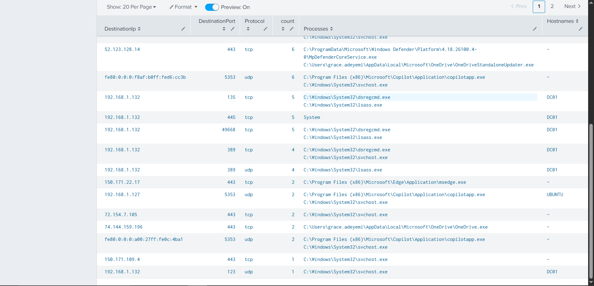
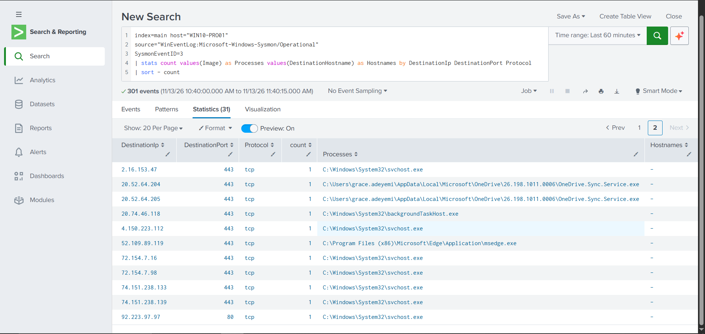

---

# 📊 Investigation Summary

The investigation established the following:

| Investigation Area | Finding |
|---|---|
| Attack source | `192.168.1.166` |
| Attack platform | Kali Linux |
| Target endpoint | WIN10-PRO01 |
| Target account | `grace.adeyemi` |
| Failed authentication | Confirmed |
| Network logon activity | Confirmed |
| Successful authentication | Investigated and identified |
| Suspicious process execution | Not identified during investigation |
| Suspicious LOLBins | Not identified during investigation |
| Suspicious network connections | Not identified during investigation |
| Evidence of additional malicious activity | Not identified during reviewed period |

---

# 🧠 Incident Findings

The investigation determined that the primary security concern was repeated authentication activity originating from the Kali Linux attack source.

The investigation confirmed the following:

1. The activity originated from:

```text
192.168.1.166
```

2. The controlled attack generated repeated failed network authentication attempts.

3. The targeted account was:

```text
grace.adeyemi
```

4. Authentication activity was reviewed for successful access following the failed attempts.

5. Post-authentication endpoint telemetry was investigated.

6. No suspicious process execution was identified during the reviewed investigation period.

7. No suspicious LOLBin activity was identified during the reviewed investigation period.

8. No suspicious network activity or malicious downloads were identified during the reviewed investigation period.

Based on the available evidence, remediation focused on strengthening authentication controls and containing the identified attack source.

---

#  Remediation

Following the investigation, several remediation and containment actions were implemented.

##  Account Password Remediation

The password associated with the targeted account was reset and replaced with a stronger password.

This reduced the risk associated with the credentials involved in the authentication incident.

### Evidence

> **Screenshot:** Account password remediation.

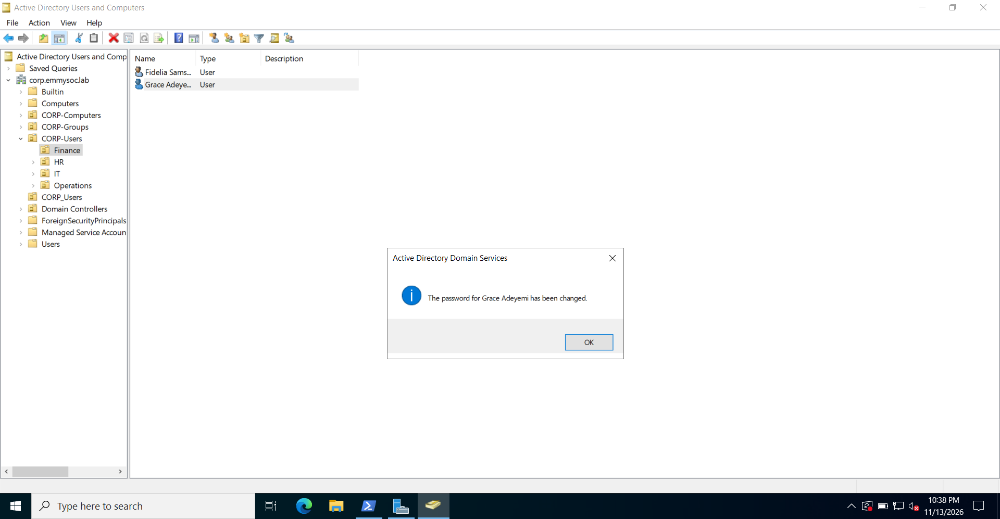

---

## 2️⃣ Account Lockout Policy

An Active Directory account lockout policy was configured to reduce the effectiveness of repeated authentication attempts.

The policy was configured with:

```text
Account Lockout Threshold: 10 invalid logon attempts
Account Lockout Duration: 30 minutes
Reset Account Lockout Counter After: 30 minutes
```

The lockout threshold was selected to align authentication protection with the investigation and detection strategy.

### Evidence

> **Screenshot:** Active Directory account lockout policy configuration.

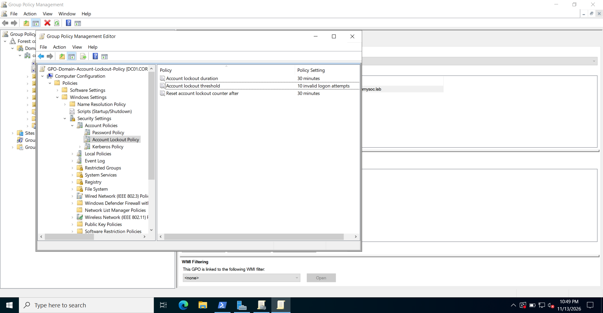

---

## 3️⃣ Attack Source Containment

The identified Kali Linux attack source was:

```text
192.168.1.166
```

A Windows Firewall inbound rule was created to block traffic originating from this IP address.

The firewall rule was configured as:

```text
Rule Name:
Block Kali Attack Source - 192.168.1.166

Direction:
Inbound

Action:
Block the connection

Remote IP Address:
192.168.1.166

Profiles:
Domain, Private, Public
```

This containment action prevented the identified attack source from continuing to access the protected Windows system through the blocked inbound traffic path.

### Evidence

> **Screenshot:** Windows Firewall rule blocking the Kali attack source.

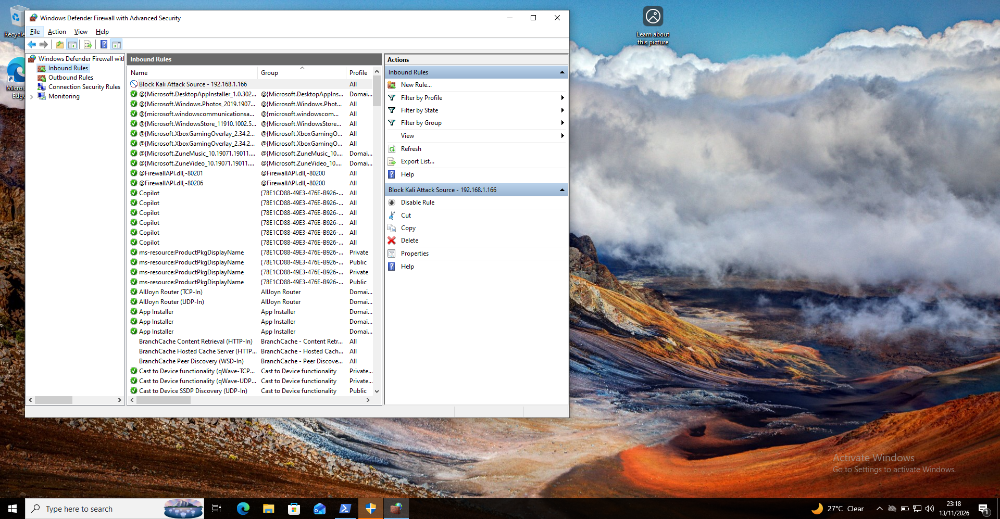

---

# ✅ Verification

After implementing the Windows Firewall containment rule, connectivity was tested again from the Kali Linux attack machine.

The previously accessible SMB service on TCP port `445` was scanned again.

### Before Remediation

```text
445/tcp open microsoft-ds
```

### After Containment

```text
445/tcp filtered microsoft-ds
```

The post-remediation result demonstrated that traffic from the Kali attack source was being filtered following implementation of the containment rule.

### Verification Evidence

> **Screenshot:** Post-remediation Nmap scan showing TCP port 445 filtered.

📸 *Add your verification screenshot here.*

---

# 🔄 SOC Incident Response Lifecycle

This project demonstrates a complete SOC investigation workflow:

### 1. Attack Simulation

A controlled authentication attack was performed from Kali Linux against the Windows environment.

### 2. Detection

Wazuh and Windows Security telemetry captured repeated failed authentication activity.

### 3. Investigation

Wazuh and Splunk were used to investigate:

- Authentication events
- Source IP information
- Successful authentication activity
- Process creation
- Parent process context
- Command lines
- Potential LOLBins
- Network connections

### 4. Findings

The investigation confirmed suspicious repeated authentication activity while no additional suspicious endpoint or network activity was identified during the reviewed investigation period.

### 5. Remediation

The environment was remediated by:

- Resetting the affected account password
- Strengthening authentication controls
- Configuring an account lockout threshold
- Blocking the identified Kali attack source IP

### 6. Verification

A post-remediation network scan confirmed that SMB traffic from the Kali attack source was filtered.

---

# 🧰 Technologies and Tools Used

### Security Monitoring

- Wazuh
- Wazuh Agent
- Wazuh Manager

### SIEM and Investigation

- Splunk Enterprise
- Splunk Universal Forwarder

### Endpoint Telemetry

- Sysmon
- Windows Security Event Logs

### Infrastructure

- Windows Server
- Active Directory Domain Services
- Group Policy
- Windows Firewall

### Attack Simulation

- Kali Linux
- Nmap
- SMB authentication testing

### Virtualization

- Oracle VirtualBox

---

# 💼 Skills Demonstrated

This project demonstrates practical SOC and security operations skills, including:

### Detection Engineering

- Creating and tuning custom Wazuh rules
- Correlating repeated authentication failures
- Using frequency and timeframe thresholds
- Correlating events based on source IP addresses

### SIEM Investigation

- Searching and filtering security telemetry
- Investigating authentication activity
- Reviewing process execution
- Analyzing parent processes and command lines
- Investigating network connections

### Windows Security

- Investigating Windows Event ID 4625
- Reviewing network logon activity
- Working with Active Directory authentication
- Configuring account lockout policies
- Creating Windows Firewall containment rules

### Endpoint Investigation

- Using Sysmon Event ID 1 for process investigation
- Using Sysmon Event ID 3 for network investigation
- Reviewing potential LOLBins
- Determining whether suspicious post-authentication activity occurred

### Incident Response

- Identifying the attack source
- Investigating the scope of activity
- Determining remediation actions
- Implementing containment
- Verifying security controls

---

# 📸 Evidence Collected

The following evidence was collected during the project:

- Initial Nmap scan showing SMB TCP/445 open
- Wazuh failed authentication alerts
- Wazuh detection rule configuration
- Splunk authentication investigation
- Successful authentication investigation
- Sysmon Event ID 1 process analysis
- Parent process and command-line analysis
- LOLBin investigation
- Sysmon Event ID 3 network connection analysis
- Active Directory account lockout policy
- Windows Firewall containment rule
- Post-remediation Nmap verification

---

# 🎓 Key Lessons Learned

This project reinforced several important SOC principles:

### Detection is only the beginning

An alert alone does not provide the complete story. Authentication alerts must be investigated alongside endpoint and network telemetry.

### Context is essential

Failed authentication events become more meaningful when correlated with:

- Source IP addresses
- Target accounts
- Successful authentication events
- Process activity
- Network connections

### Post-authentication investigation is critical

A successful authentication event does not automatically prove compromise. Analysts must investigate whether additional activity occurred after authentication.

### Containment should be evidence-based

The source IP was identified during the investigation before containment was implemented.

### Verification is part of remediation

Security controls should be tested after implementation. The post-remediation Nmap result provided evidence that the containment control changed the accessibility of the previously reachable SMB service.

---

# 🚀 Future Improvements

Potential improvements for this lab include:

- Integrating Wazuh Active Response for automated containment after defined investigation and response conditions
- Testing additional authentication attack scenarios
- Creating additional correlation rules for successful logons following repeated failures
- Building additional Splunk dashboards for authentication investigations
- Integrating DFIR-IRIS for formal incident case management and documentation
- Expanding detection engineering for additional Windows attack techniques

---

# 📌 Conclusion

This project demonstrates a practical end-to-end SOC workflow in a Windows Active Directory environment.

A controlled authentication attack was simulated from Kali Linux and investigated using Wazuh, Splunk, Windows Security Event Logs, and Sysmon.

The investigation identified repeated authentication activity, attributed the activity to a specific source IP, and examined endpoint telemetry to determine whether additional suspicious activity occurred.

Following the investigation, remediation controls were implemented to strengthen authentication security and contain the identified attack source.

Finally, the containment action was verified through post-remediation network testing.

The completed workflow demonstrates practical experience across:

> **Detection Engineering → SIEM Investigation → Endpoint Analysis → Active Directory Security → Incident Response → Containment → Verification**
